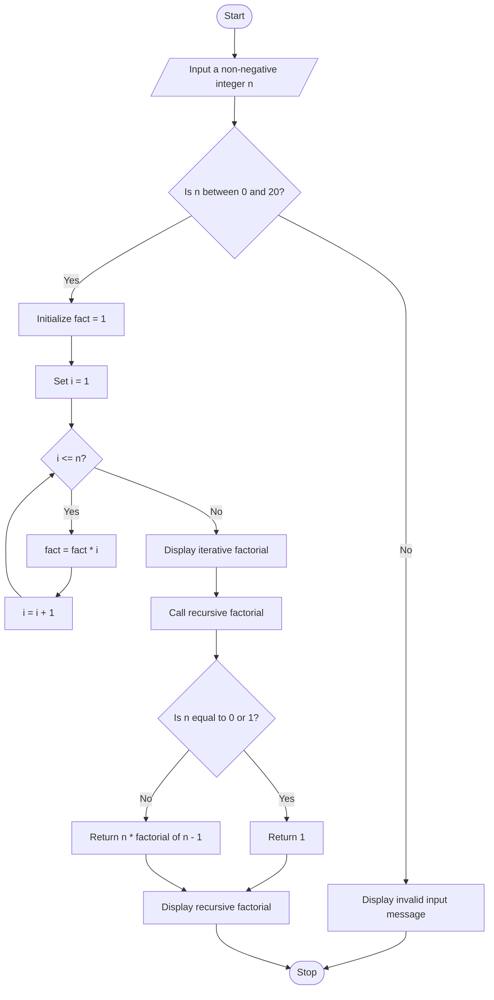

# Factorial-of-a-number-with-and-without-recursion

# Assignment 6: Factorial Using Recursion and Iteration in C

## 1. Problem Statement

Write a C program using user-defined functions to calculate the factorial of a number with and without recursion.

## 2. Objectives

- To learn and understand user-defined functions in C.
- To understand the concept of recursive functions.
- To calculate the factorial of a number using iteration.
- To calculate the factorial of a number using recursion.
- To understand the use of the `return` statement in functions.
- To differentiate between formal and actual arguments.

## 3. Theory

### What is a Function?

A function is a block of code designed to perform a specific task. Functions help divide a program into smaller, manageable sections and improve code reusability, readability, testing, and maintenance.

Functions in C are broadly classified into:

1. **Library functions:** Predefined functions provided by the C standard library, such as `printf()`, `scanf()`, and `strlen()`.
2. **User-defined functions:** Functions created by programmers to perform specific tasks, such as calculating the factorial of a number.

**Syntax:**

```c
return_type function_name(parameter_list) {
    // Statements
    return value;
}
```

**Example:**

```c
int add(int a, int b) {
    return a + b;
}
```

### What is Factorial?

The factorial of a non-negative integer is the product of all positive integers less than or equal to that number. It is represented by the symbol `!`.

**Mathematical definition:**

\[
n! = n \times (n-1) \times (n-2) \times \cdots \times 1
\]

The factorial of zero is defined as:

\[
0! = 1
\]

**Examples:**

| Number | Calculation | Factorial |
|---|---|---:|
| 0 | By definition | 1 |
| 1 | `1` | 1 |
| 3 | `3 × 2 × 1` | 6 |
| 4 | `4 × 3 × 2 × 1` | 24 |
| 5 | `5 × 4 × 3 × 2 × 1` | 120 |

### What is Iteration?

Iteration is a programming technique in which a set of statements is repeated using a loop until a specified condition becomes false.

In factorial calculation, a loop multiplies all integers from `1` to `n`.

**Example:**

```c
int factorial_iterative(int n) {
    int fact = 1;

    for (int i = 1; i <= n; i++) {
        fact = fact * i;
    }

    return fact;
}
```

For `n = 5`, the calculation proceeds as follows:

```text
fact = 1
fact = 1 * 1 = 1
fact = 1 * 2 = 2
fact = 2 * 3 = 6
fact = 6 * 4 = 24
fact = 24 * 5 = 120
```

Therefore, the factorial of `5` is `120`.

### What is a Recursive Function?

A recursive function is a function that calls itself to solve a problem by reducing it to smaller instances of the same problem.

The factorial function can be defined recursively as:

\[
n! =
\begin{cases}
1, & n = 0 \text{ or } n = 1 \\
n \times (n-1)!, & n > 1
\end{cases}
\]

**Example:**

```c
int factorial_recursive(int n) {
    if (n == 0 || n == 1) {
        return 1;
    }

    return n * factorial_recursive(n - 1);
}
```

The condition `n == 0 || n == 1` is called the **base case**. It stops the recursive calls.

For `n = 5`, the recursive calculation is:

```text
factorial_recursive(5)
= 5 * factorial_recursive(4)
= 5 * 4 * factorial_recursive(3)
= 5 * 4 * 3 * factorial_recursive(2)
= 5 * 4 * 3 * 2 * factorial_recursive(1)
= 5 * 4 * 3 * 2 * 1
= 120
```

### What is the Return Statement?

The `return` statement terminates a function and sends a value back to the calling function when the function has a non-void return type.

**Example:**

```c
int square(int n) {
    return n * n;
}
```

If `square(4)` is called, the function returns `16`.

### What are Formal and Actual Arguments?

- **Formal arguments:** Variables declared in the function definition that receive values from the calling function.
- **Actual arguments:** Values or expressions supplied when a function is called.

**Example:**

```c
int multiply(int a, int b) {
    return a * b;
}

int main() {
    int result = multiply(3, 4);
    return 0;
}
```

Here, `a` and `b` are formal parameters, while `3` and `4` are actual arguments.

## 4. Algorithm

### A. Factorial Without Recursion

1. Start the program.
2. Declare the required variables.
3. Accept a non-negative integer from the user.
4. Initialize the factorial variable to `1`.
5. Use a `for` loop from `1` to the entered number.
6. Multiply the factorial variable by the loop counter during each iteration.
7. Display the calculated factorial.
8. Stop the program.

### B. Factorial With Recursion

1. Start the program.
2. Accept a non-negative integer from the user.
3. Call the recursive factorial function.
4. Check whether the number is `0` or `1`.
5. If the base case is satisfied, return `1`.
6. Otherwise, multiply the number by the factorial of the previous integer.
7. Continue the recursive calls until the base case is reached.
8. Return the final result.
9. Display the calculated factorial.
10. Stop the program.

## 5. C Program

```c
#include <stdio.h>

unsigned long long factorial_iterative(int n) {
    unsigned long long fact = 1;

    for (int i = 1; i <= n; i++) {
        fact = fact * i;
    }

    return fact;
}

unsigned long long factorial_recursive(int n) {
    if (n == 0 || n == 1) {
        return 1;
    }

    return n * factorial_recursive(n - 1);
}

int main() {
    int n;

    printf("Enter a non-negative integer (0-20): ");
    scanf("%d", &n);

    if (n < 0 || n > 20) {
        printf("Please enter a number between 0 and 20.\n");
        return 1;
    }

    printf("Factorial using iteration = %llu\n",
           factorial_iterative(n));

    printf("Factorial using recursion = %llu\n",
           factorial_recursive(n));

    return 0;
}
```

**Note:** The program restricts the input to `0` through `20` because `20!` fits within the range of a typical 64-bit `unsigned long long` integer, whereas `21!` does not.

## 6. Sample Input and Output

### Example 1: Factorial of 5

**Input:**

```text
Enter a non-negative integer (0-20): 5
```

**Output:**

```text
Factorial using iteration = 120
Factorial using recursion = 120
```

### Example 2: Factorial of 0

**Input:**

```text
Enter a non-negative integer (0-20): 0
```

**Output:**

```text
Factorial using iteration = 1
Factorial using recursion = 1
```

### Example 3: Factorial of 4

**Input:**

```text
Enter a non-negative integer (0-20): 4
```

**Output:**

```text
Factorial using iteration = 24
Factorial using recursion = 24
```

### Example 4: Negative Input

**Input:**

```text
Enter a non-negative integer (0-20): -3
```

**Output:**

```text
Please enter a number between 0 and 20.
```

## 7. Flowchart



## 8. FAQs

### Q1. What is a recursive function?

A recursive function is a function that calls itself to solve a problem by breaking it into smaller subproblems. A base case is required to terminate the recursive calls and prevent infinite recursion.

### Q2. What are the advantages of user-defined functions?

- **Code reusability:** Functions can be called multiple times without rewriting the same code.
- **Modularity:** Programs can be divided into smaller, manageable parts.
- **Readability:** Functions make the program easier to understand.
- **Debugging:** Individual functions can be tested separately.
- **Maintenance:** Changes can be made to a particular function without rewriting the entire program.

### Q3. What is the difference between recursion and iteration?

Iteration uses loops such as `for` and `while` to repeat statements, whereas recursion uses repeated function calls. Iteration generally uses less memory for factorial calculation, while recursion requires additional call-stack space.

### Q4. What is the base case in a recursive factorial function?

The base case is the condition that stops further recursive calls. For factorial, the base case is `n == 0 || n == 1`, which returns `1`.

### Q5. Why is the factorial of zero equal to one?

The factorial of zero is defined as one mathematically. This definition also makes the factorial formula consistent with the recurrence relation `n! = n * (n - 1)!`.

## 9. Conclusion

Thus, a C program was implemented successfully to calculate the factorial of a number using both iterative and recursive functions. This experiment helped develop an understanding of user-defined functions, recursive function calls, base cases, return statements, and formal and actual arguments. It also demonstrated the differences between iteration and recursion in solving mathematical problems.
